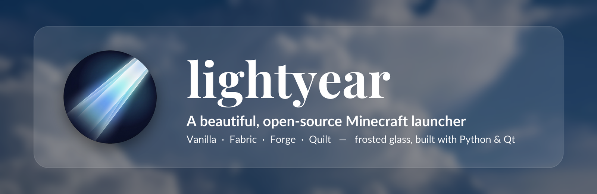
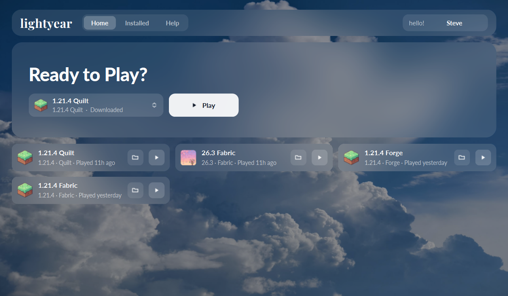
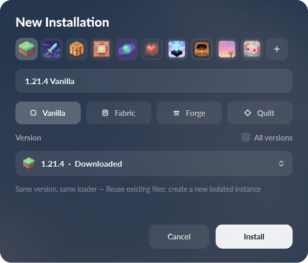
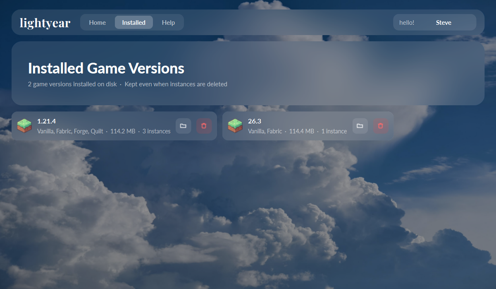
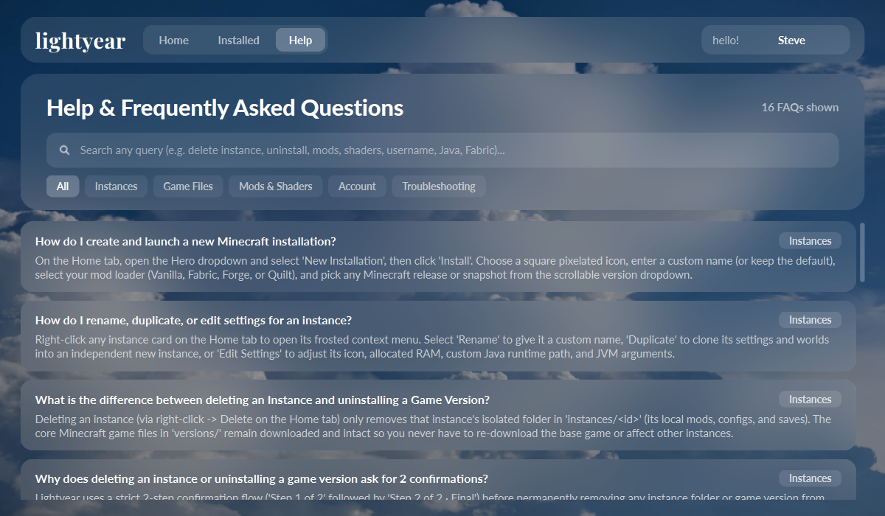
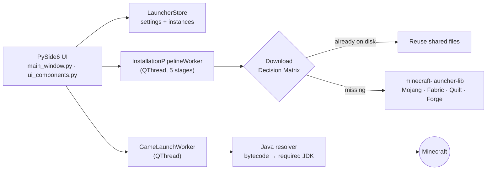
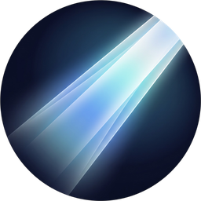

<div align="center">



<br />

**A fast, minimalist Minecraft launcher with a frosted-glass interface.**<br />
Isolated instances · Vanilla, Fabric, Forge & Quilt · Smart shared downloads · Automatic Java detection

<br />

[](https://github.com/firearz/lightyear-launchpad/releases/latest)
[](https://github.com/firearz/lightyear-launchpad/releases)
[](LICENSE)

[](https://github.com/firearz/lightyear-launchpad/actions/workflows/ci.yml)
[](https://www.python.org/)
[-41CD52?style=flat-square&logo=qt&logoColor=white)](https://doc.qt.io/qtforpython-6/)
[](#-installation)
[](https://github.com/firearz/lightyear-launchpad/stargazers)

[**Download**](https://github.com/firearz/lightyear-launchpad/releases/latest) ·
[**Features**](#-features) ·
[**Screenshots**](#-screenshots) ·
[**Build from source**](#-build-from-source) ·
[**FAQ**](#-faq) ·
[**Contributing**](CONTRIBUTING.md)

</div>

---

## ✨ Overview

**Lightyear** is a free, open-source Minecraft: Java Edition launcher for Windows. It focuses on three things:

- **Looking beautiful.** The interface uses blurred frosted glass, custom typography (Playfair Display + Lato), and pixel-art instance icons.
- **Staying out of your way.** Pick a version and press Play. The launcher hides while you play and comes back when you quit.
- **Respecting your disk.** Game files are shared across instances, so a new instance of an installed version is ready in seconds.

<br />

## 📸 Screenshots

<div align="center">


<sub><b>Home</b> — hero launcher, last-played instance and quick-launch cards</sub>

<br /><br />

<table>
  <tr>
    <td width="50%"></td>
    <td width="50%"></td>
  </tr>
  <tr>
    <td align="center"><sub><b>New installation</b> — icon, loader and version picker</sub></td>
    <td align="center"><sub><b>Installed</b> — manage the game versions on disk</sub></td>
  </tr>
</table>


<sub><b>Help</b> — searchable, categorised FAQ built into the app</sub>

</div>

<br />

## 🚀 Features

<table>
<tr>
<td width="50%" valign="top">

### 🧊 Frosted-glass UI
- Real-time Gaussian-blurred glass panels over a scenic backdrop
- Custom fonts, smooth wheel scrolling, Apple-style popover menus
- 10 built-in pixel-art icons, or use any image of your own
- Fixed window size, so the layout always looks the way it was designed

### 📦 Isolated instances
- Each instance has its own `saves/`, `mods/`, `resourcepacks/`, `shaderpacks/`
- Rename, duplicate (worlds included), repair or delete from the right-click menu
- Per-instance RAM, Java path and custom JVM arguments
- Add mods, resource packs and shaders in one click

</td>
<td width="50%" valign="top">

### ⚡ Smart download engine
- **Download Decision Matrix**: game files you already have are reused, never downloaded again
- Shared `versions/`, `libraries/` and `assets/` across every instance
- SHA-1 and ZIP/JAR integrity checks with retries (exponential backoff)
- 5-stage background install pipeline you can cancel at any time

### 🧩 Mod loaders and Java
- **Vanilla, Fabric, Forge and Quilt**: releases, snapshots, beta and alpha
- Automatic Java detection from each version's bytecode requirement (Java 8 → 25+)
- Guided Adoptium download if a compatible Java is missing
- Offline UUIDs that match Java exactly (`OfflinePlayer:<name>`), so your LAN and singleplayer data stays consistent

</td>
</tr>
</table>

<br />

## 📥 Installation

### Option 1: Download the app (recommended)

1. Go to the [**latest release**](https://github.com/firearz/lightyear-launchpad/releases/latest).
2. Download **`Lightyear-<version>-windows-x64.exe`** (single file) or the **`-portable.zip`** (faster startup).
3. Run it. No installer and no admin rights needed.

> [!NOTE]
> The executable is not code-signed yet, so Windows SmartScreen may show *"Windows protected your PC"*.
> Click **More info → Run anyway**. Every release is built in public by
> [GitHub Actions](https://github.com/firearz/lightyear-launchpad/actions) from the source code in this repository.

### Option 2: Run from source

```powershell
git clone https://github.com/firearz/lightyear-launchpad.git
cd lightyear-launchpad
python -m venv .venv
.venv\Scripts\activate
pip install -r requirements.txt
python main.py
```

Or double-click **`LaunchLightyear.bat`** to start without a console window.

### Requirements

| Component | Requirement |
| --- | --- |
| OS | Windows 10 / 11 (64-bit) |
| Python *(source only)* | 3.10 or newer |
| Java | Detected automatically. Install [Temurin](https://adoptium.net/) if prompted |
| Disk | ~150 MB per Minecraft version (shared across instances) |

<br />

## 🎮 Usage

| Action | How |
| --- | --- |
| **Create an instance** | Hero dropdown → *New Installation* → choose icon, loader, version → **Install** |
| **Play** | Pick an instance in the hero dropdown → **Play**, or ▶ on any card |
| **Change username** | Double-click the `hello! <name>` pill in the top-right |
| **Mods / packs / shaders** | Right-click an instance → *Add Mods / Resource Packs / Shaderpacks* |
| **Edit RAM / Java / JVM args** | Right-click an instance → *Edit Settings* |
| **Fix a broken install** | Right-click an instance → *Repair Installation* |
| **Free disk space** | **Installed** tab → 🗑 on a version (asks you to confirm twice) |
| **Show snapshots / old versions** | Tick **All versions** in the New Installation dialog |

<br />

## 🏗️ How it works



### Data layout

Launcher data lives in `%APPDATA%\LightYieldLauncher\`:

```text
LightYieldLauncher/
├── versions/      # shared game JARs + loader profiles
├── libraries/     # shared Maven libraries
├── assets/        # shared sounds, textures, languages
├── runtime/       # Mojang-provided Java runtimes
├── instances/
│   └── <id>/      # saves/ mods/ resourcepacks/ shaderpacks/ screenshots/
├── installations.json
└── lightyear_settings.json
```

### Project structure

```text
lightyear-launchpad/
├── main.py                 # entry point: fonts, DPI, app icon, window
├── LaunchLightyear.bat     # console-less launcher for Windows
├── lightyear/
│   ├── core.py             # backend: store, downloads, Java, launch workers
│   ├── main_window.py      # main window and page routing
│   └── ui_components.py    # frosted-glass widgets, dialogs, pages
├── assets/                 # logo, backdrop, fonts, instance icons
├── docs/                   # README images & screenshots
└── lightyear.spec          # PyInstaller build recipe
```

<br />

## 🔨 Build from source

```powershell
pip install -r requirements-dev.txt

# Single-file executable  →  dist\Lightyear.exe
pyinstaller lightyear.spec --noconfirm

# Portable folder         →  dist\Lightyear\Lightyear.exe
$env:LIGHTYEAR_ONEDIR = "1"; pyinstaller lightyear.spec --noconfirm
```

### Publishing a release

Releases are fully automated. Push a version tag and GitHub Actions builds both artifacts, then publishes them to a new GitHub Release:

```powershell
git tag v1.0.0
git push origin v1.0.0
```

<br />

## ❓ FAQ

<details>
<summary><b>Does Lightyear support Microsoft / Mojang account login?</b></summary>
<br />
Not yet. Lightyear currently uses <b>offline-mode</b> profiles, which work for singleplayer and LAN.
Microsoft account sign-in is on the <a href="#-roadmap">roadmap</a>. Please <a href="https://www.minecraft.net/store/minecraft-java-bedrock-edition-pc">buy Minecraft</a> to support its developers.
</details>

<details>
<summary><b>Which Java version do I need?</b></summary>
<br />
Lightyear works this out for you. Roughly: <b>Java 8</b> for 1.16.5 and older, <b>Java 17</b> for 1.17–1.20.4,
<b>Java 21</b> for 1.20.5–1.21.x, and <b>Java 25+</b> for 26.x. If none is found, it shows you where to download one.
</details>

<details>
<summary><b>Will deleting an instance delete the game files?</b></summary>
<br />
No. Deleting an instance only removes its own folder (worlds, mods, configs). The shared game files stay,
so other instances keep working. To remove a version completely, use the <b>Installed</b> tab.
</details>

<details>
<summary><b>Where are my worlds and screenshots?</b></summary>
<br />
In <code>%APPDATA%\LightYieldLauncher\instances\&lt;id&gt;\</code>. Click the 📁 button on any instance card to open the folder.
</details>

<details>
<summary><b>Windows says the app is unsafe. Is it?</b></summary>
<br />
The executable isn't code-signed yet (certificates are expensive), so SmartScreen warns about it.
The full source is here, and every release binary is built publicly by GitHub Actions. You can also run it from source.
</details>

<br />

## 🗺️ Roadmap

- [x] Isolated instances with shared game files
- [x] Vanilla, Fabric, Forge and Quilt
- [x] Automatic Java detection and guidance
- [x] Repair, duplicate, rename and per-instance settings
- [ ] Microsoft account sign-in
- [ ] Modrinth / CurseForge mod browser
- [ ] Modpack import (`.mrpack`, CurseForge zip)
- [ ] Skin preview and management
- [ ] Linux & macOS builds
- [ ] Built-in auto-updater

Have an idea? [Open a feature request](https://github.com/firearz/lightyear-launchpad/issues/new?template=feature_request.yml).

<br />

## 🤝 Contributing

Contributions of all sizes are welcome: bug reports, docs, UI polish, new features.
Read the [**Contributing Guide**](CONTRIBUTING.md) to get started, and follow our [**Code of Conduct**](CODE_OF_CONDUCT.md).

Found a security issue? Please report it privately. See [**SECURITY.md**](SECURITY.md).

<br />

## 🙏 Acknowledgements

- [**minecraft-launcher-lib**](https://codeberg.org/JakobDev/minecraft-launcher-lib) by JakobDev, which powers installs and launch commands
- [**Qt for Python (PySide6)**](https://doc.qt.io/qtforpython-6/), the UI framework
- [**Pillow**](https://python-pillow.org/), for image processing and the blur engine
- [**Lato**](https://fonts.google.com/specimen/Lato) & [**Playfair Display**](https://fonts.google.com/specimen/Playfair+Display), licensed under the SIL Open Font License
- [**Eclipse Temurin**](https://adoptium.net/), the recommended Java runtime

See [THIRD_PARTY_NOTICES.md](THIRD_PARTY_NOTICES.md) for full license details.

<br />

## 📄 License

Lightyear is released under the [**MIT License**](LICENSE).

> [!IMPORTANT]
> **NOT AN OFFICIAL MINECRAFT PRODUCT. NOT APPROVED BY OR ASSOCIATED WITH MOJANG OR MICROSOFT.**
> "Minecraft" is a trademark of Mojang Synergies AB. Lightyear downloads game files directly from Mojang's official servers and does not distribute any Minecraft game assets.

<div align="center">
<br />

<br />
<sub>Made with 💙 by <a href="https://github.com/firearz">firearz</a> and contributors.<br />If Lightyear is useful to you, please consider giving it a ⭐</sub>
</div>
