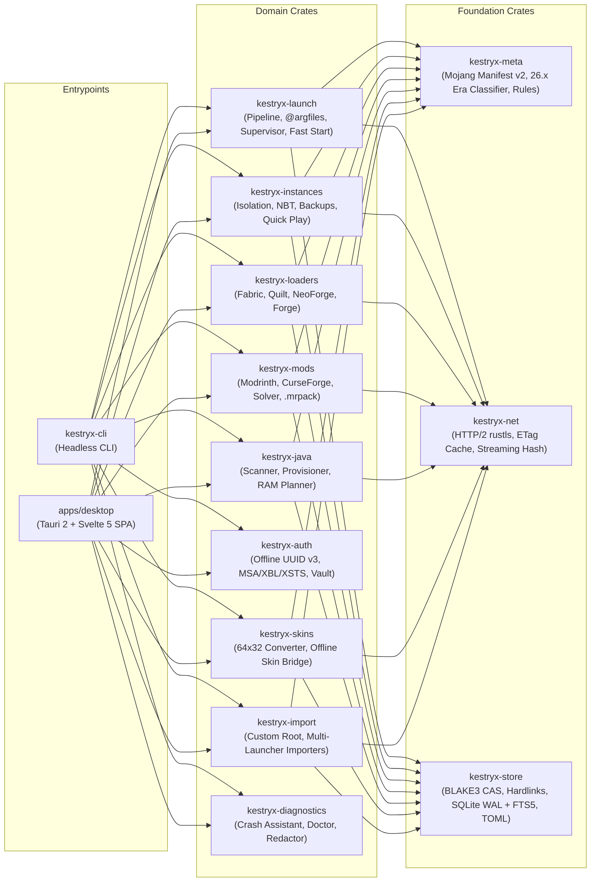
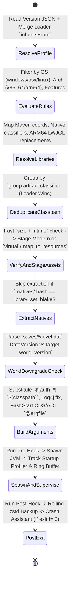

# Kestryx Architecture (`docs/ARCHITECTURE.md`)

## 1. High-Level Crate & Module Topology

**Kestryx** is structured as a strict clean-room monorepo where all file, network, authentication, loader, and process logic resides in a zero-UI-dependency Rust workspace (`crates/*`), shared identically between the headless CLI (`kestryx-cli`) and the desktop application (`apps/desktop`).

## 2. Launch Pipeline State Machine

## 3. Fast Startup & Tray Memory Architecture

1. **Cold Start (`<= 400 ms` p50)**:
   - On launch, the host reads `state_snapshot.json` synchronously and serves the initial instance list to the Svelte 5 SPA before any network request is made.
   - Background hydration (`SQLite WAL`, ETag refresh, disk mtime verification) runs asynchronously on Tokio workers and pushes incremental diffs.
2. **Hidden to Tray (`<= 40 MB` RAM)**:
   - When closed/minimized to the system tray (`close_behavior = "tray"`), Kestryx destroys the OS webview window handle while keeping the lightweight Rust background daemon alive to monitor running game processes or downloads.
